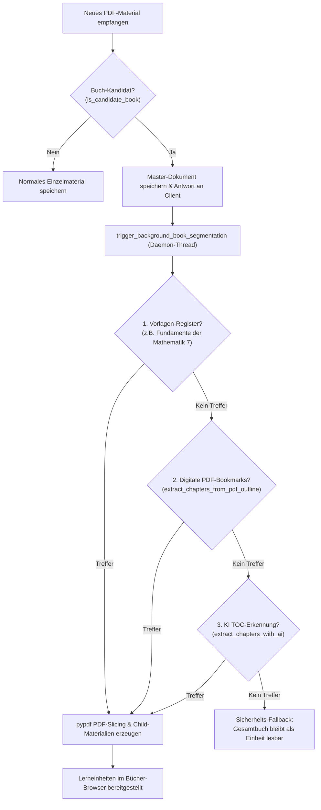

# 02.8 Schulbücher & Lehrwerke-Browser (`book_browser`)

## 1. Übersicht & Zielsetzung

Mit dem **Bücher-Browser** (`#tab-books`) erhält GoThea eine spezialisierte Ansicht zum Durchblättern und interaktiven Erkunden kompletter Schulbücher und Lehrwerke.

Schulbücher (wie das 196-seitige Mathematik-Lehrbuch für die 7. Klasse) sind als zusammenhängende Groß-PDFs (oft 60 MB+) auf Tablets unhandlich, langsam zu laden und unübersichtlich. Der Bücher-Browser löst dies durch eine strukturierte **Master-Detail-Architektur**:
* **Bücher-Regal (Shelf):** Schneller Wechsel zwischen verfügbaren Lehrwerken nach Schulfach und Klassenstufe.
* **Inhaltsverzeichnis & Sektions-Navigator (TOC):** Schneller Direktzugriff auf alle Lerneinheiten und Kapitel mit Seitenzahlen, Themenzuordnung und didaktischen Schwerpunkten.
* **Sektions-Reader & Seiten-Viewer:** Gestochen scharfes Retina-Rendering einzelner Buchseiten (150 DPI) ohne Speicherengpässe auf dem Raspberry Pi.
* **One-Tap Tafel-Übernahme:** Jede beliebige Buchseite oder Lerneinheit kann mit einem Klick (*„🎨 Auf Tafel öffnen“*) direkt in die Whiteboard-Engine als Arbeitsblatt übernommen werden.

---

## 2. Master-Child Datenmodell & Segmentierung

Die Repräsentation in der Datenbank ([Material](file:///Users/thilo/Library/CloudStorage/SynologyDrive-DatenSync/Repos/GoThea/backend/app/models/material.py) & [Dossier](file:///Users/thilo/Library/CloudStorage/SynologyDrive-DatenSync/Repos/GoThea/backend/app/models/dossier.py)) baut auf der Master-Child-Hierarchie auf:

```
[ Dossier: "Mathematik – Lehrbuch 7. Klasse" ] (kind = 'lehrbuch')
   │
   ├── Master [ Material: id = "mat_book_math_7" ] (kind = 'Buch', 196 Seiten)
   │     │
   │     ├── Child [ Material: "Kapitel 0: Titelei & Konzept" ] (S. 1–9)
   │     ├── Child [ Material: "Lerneinheit 1: Zahlen & Rechenoperationen" ] (S. 10–21)
   │     ├── Child [ Material: "Lerneinheit 2: Das Viereck" ] (S. 22–49)
   │     ├── Child [ Material: "Lerneinheit 3: Reelle Zahlen & Wurzeln" ] (S. 50–77)
   │     ├── Child [ Material: "Lerneinheit 4: Länge, Umfang & Fläche" ] (S. 78–89)
   │     ├── Child [ Material: "Lerneinheit 5: Der Kreis" ] (S. 90–111)
   │     ├── Child [ Material: "Lerneinheit 6: Ähnlichkeit der Dreiecke" ] (S. 112–137)
   │     ├── Child [ Material: "Lerneinheit 7: Gleichungssysteme" ] (S. 138–151)
   │     ├── Child [ Material: "Lerneinheit 8: Satz des Pythagoras" ] (S. 152–173)
   │     ├── Child [ Material: "Lerneinheit 9: Datenverarbeitung" ] (S. 174–187)
   │     └── Child [ Material: "Anhang: Jahreswiederholung & Lösungen" ] (S. 188–196)
```

Jedes Kind-Material speichert:
* `parent_id`: Verweis auf das Master-Buch
* `start_page` & `end_page`: Reale Buchseitennummerierung
* `page_count`: Umfang des Kapitels
* `topic_id`: Verknüpfung mit dem Brandenburger Rahmenlehrplan (RLP)
* `summary`: Didaktische Schwerpunkte (Formeln, Lehrsätze, Methoden)

---

## 2.1 Vollautomatische Buch-Segmentierungs-Pipeline (`book_segmentation.py`)

Sobald ein Schulbuch hochgeladen wird oder über die Inbox eintrifft, zerlegt der Dienst [`backend/app/services/book_segmentation.py`](file:///Users/thilo/Library/CloudStorage/SynologyDrive-DatenSync/Repos/GoThea/backend/app/services/book_segmentation.py) das Gesamt-PDF vollautomatisch in seine einzelnen Lerneinheiten:



### Die 3 Erkennungsstufen der Pipeline:
1. **Stufe 1 – Vorlagen-Register (`FUNDAMENTE_MATHE_7_CHAPTERS`)**:
   * Für bekannte Schulbücher der 7. Klasse greift ein verifiziertes, hochpräzises Kapitelmapping mit Seitengrenzen, Lehrplanthemen und Kompetenzen.
2. **Stufe 2 – Digitale PDF-Bookmarks (`extract_chapters_from_pdf_outline`)**:
   * Bei digitalen Verlagsausgaben (Cornelsen, Klett, Westermann) parst `pypdf` die eingebettete Dokument-Outline (`reader.outline`).
   * Funktioniert deterministisch in **unter 0,1 Sekunden**, völlig offline und ohne jegliche KI-Token-Kosten.
3. **Stufe 3 – Multimodale KI-Inhaltsverzeichnis-Analyse (`extract_chapters_with_ai`)**:
   * Bei gescannten Schulbüchern ohne digitale Lesezeichen extrahiert das System Text von den Seiten 1–8.
   * Fehlt digitaler Text, rendert das System die Seiten 2–5 als Bilder und übergibt sie an OpenAI Vision (`gpt-4o-mini`). Die KI liest das Inhaltsverzeichnis, gleicht den Seitennummern-Offset ab und liefert eine strukturierte JSON-Kapitelliste zurück.

### Asynchroner Hintergrund-Betrieb & Entkopplung:
* Das physische Slicing von 300-Seiten-PDFs in 11 Kapitel-PDFs dauert auf dem Raspberry Pi ca. 2–3 Sekunden.
* Durch `trigger_background_book_segmentation` antwortet der Web-Upload und der Inbox-Scanner **sofort**. Das Slicing und Verknüpfen der Child-Materialien läuft vollständig im Hintergrund.

### Sicherheits-Fallback (Nie wieder Sackgassen):
* Falls ein hochgeladenes Buch keine erkennbaren Kapitel hat (z. B. eine durchgehende Schullektüre), blendet der Bücher-Browser automatisch die Option **„📖 Gesamtes Buch aufschlagen (Alle Seiten durchblättern)“** ein. Das Master-Buch kann von Seite 1 bis Ende nahtlos gelesen und auf die Tafel übernommen werden.

### Nachträgliche Klassifizierung & Typänderung auf „Buch“:
* Wird ein bestehendes Material nachträglich über das Bearbeiten-Modal auf **„Schulbuch / Lehrbuch (Gesamtwerk)“** (`kind = "Buch"`) umgestellt (oder als `Buchauszug` mit $\ge 20$ Seiten gespeichert), führt [`update_material`](file:///Users/thilo/Library/CloudStorage/SynologyDrive-DatenSync/Repos/GoThea/backend/app/services/material_ingestion.py) folgende Aktionen automatisch aus:
  1. Setzt den kanonischen Typ `material.kind = "Buch"`.
  2. Aktualisiert oder erstellt das zugehörige Dossier als `kind = "lehrbuch"` mit Titel-Präfix `Lehrbuch: <Titel>`.
  3. Startet die Segmentierungs-Pipeline im Hintergrund (`trigger_background_book_segmentation`), falls noch keine Kapitel existieren.
  4. Nimmt das Werk sofort in die Bücherliste (`GET /api/v1/books`) auf.
  5. Aktualisiert das Frontend-Bücherregal unmittelbar per `loadBooks()`.

---

## 3. UI-Komponenten & Interaktion

### 1. Bücher-Regal (`#books-shelf-selector`)
* Übersicht der verfügbaren Lehrwerke mit Fach-Icon, Titel, Autoren und Lerneinheiten.
* Ermöglicht das Umschalten zwischen Büchern mit sofortiger Aktualisierung des Inhaltsverzeichnisses.

### 2. Kapitel-Katalog (`#book-catalog-view`)
* **Übersichts-Kacheln:** Präsentiert alle Lerneinheiten in einem aufgeräumten, responsiven Raster (Grid) mit Einheit-Badge, Titel, Seitenzahlen (`S. 22–49 (28 S.)`), Rahmenlehrplan-Themen und didaktischem Schwerpunkt.
* **Echtzeit-Suche:** Sofortiges Filtern nach Kapiteltiteln, Themen oder Stichworten (z. B. *"Viereck"*, *"Kreis"*, *"Pythagoras"*).
* **Fokus-Öffnen:** Ein Klick auf eine Kachel öffnet nahtlos den vollbreiten Reader für dieses Kapitel.

### 3. Vollbreiter Sektions-Reader (`#book-reader-view`)
* **100% Dokumentbreite:** Keine störende Seitenleiste neben dem Dokument – die Buchseite füllt die gesamte Bildschirmbreite aus, sodass Formeln, Graphiken und Texte auf Tablets (z. B. iPad) groß, gestochen scharf und optimal lesbar sind.
* **Standard-Modus:** Automatisch auf volle Dokumentbreite (`mode-width`) voreingestellt mit vertikalem Scrollen.
* **Navigation & Quick-Jump:**
  * *← Alle Kapitel:* Rückkehr zur Katalog-Übersicht.
  * *☰ Kapitel wechseln:* Öffnet einen Offcanvas-Drawer von links zum schnellen Kapitelwechsel ohne die Leseposition zu verlassen.
  * *◀ Vorh. Einheit / Nächste Einheit ▶:* Direktes Weiterspringen zum nächsten Kapitel.
  * *◀ Vorherige Seite / Nächste Seite ▶:* Blättern innerhalb der Lerneinheit.
  * *Schnellauswahl-Pills:* Klickbare Seitennummern am unteren Rand zum direkten Anspringen.
* **Tafel-Übernahme:** *„🎨 Auf Tafel öffnen“* übernimmt das Dokument direkt auf das Whiteboard.
* **PDF-Download:** Direkter Downloadlink des segmentierten Kapitels.

### 4. Whiteboard-Übergabe
* Über den Button **„🎨 Auf Tafel öffnen“** wird die aktive Lerneinheit direkt in die Whiteboard-Engine übergeben (`loadWorksheetOnWhiteboard`). Die Schülerin kann Buchaufgaben direkt mit dem Apple Pencil auf der Tafel lösen und handschriftliche Rechenschritte festhalten.

---

## 4. Priorisiertes Hintergrund-Rendering & Smart Prefetching

Um jegliche Wartezeiten beim Blättern zu eliminieren, setzt GoThea auf den `PageRenderingService` mit einer mehrstufigen Prioritäts-Warteschlange:

| Stufe | Priorität | Auslöser | Verhalten |
|---|---|---|---|
| **1 (LIVE)** | Höchste | Direkter Seitenaufruf im Browser (`GET /preview`) | Fast-Path: Sofortige Auslieferung aus Cache (< 5 ms) oder direktes Rendern mit 100% CPU. Pausiert Hintergrund-Jobs. |
| **2 (PREFETCH)** | Hoch | Blättern zu Seite `P` | Reicht `P+1`, `P-1` und `P+2` mit Priorität 2 ein. Lädt Seiten parallel im Browser vor. |
| **3 (BACKGROUND)** | Niedrig | Serverstart / Neuer Dokumenten-Upload | Wandert im Leerlauf mit gedrosselter Priorität durch alle noch ungerenderten Seiten aller Dokumente. |

* **Zero-Wait Caching**: Jede gerenderte Seite wird als kompaktes JPEG (120 DPI) persistent unter `data/cache/rendered_pages/` abgelegt.
* **CPU-Schonung auf dem Raspberry Pi**: Der Hintergrund-Worker pausiert bei Live-Anfragen sofort und legt Mikropausen (40 ms) zwischen Seiten ein.

---

---

## 5. Handschriftliche Buch-Notizen & Inking-Engine (`book_annotations`)

Zur aktiven Textarbeit direkt im Schulbuch (Randnotizen, Formelmarkierungen, Hervorhebungen) verfügt der Buch-Reader über eine hardwarebeschleunigte, vektorbasierte **Inking-Engine** mit voller Apple-Pencil-Unterstützung auf iPadOS Safari:

### 1. Canvas-Overlay & Koordinaten-Invarianz
* Über der gerenderten Buchseite (`#book-page-img`) liegt ein synchron skalierter, transparenter HTML5-Canvas (`#book-annotation-canvas`).
* **Auflösungs-Unabhängigkeit:** Alle handschriftlichen Striche werden in **normalisierten Relativkoordinaten** ($x_{norm} \in [0, 1], y_{norm} \in [0, 1]$ bezogen auf Bildbreite und -höhe) abgespeichert.
* **Responsive Anpassung:** Bei Fenstergrößenänderungen oder Wechsel zwischen „Volle Breite“ und „Ganze Seite“ skaliert das Vektor-Rendering absolut verlustfrei und formtreu mit (`syncBookAnnotationCanvasSize`).

### 2. Palm Rejection (Handballenschutz) & 2-Finger-Gesten
* **Stift-Modus (`✏️ Nur Stift`):** Ist standardmäßig aktiviert. Sämtliche Touch-Ereignisse mit `pointerType === "touch"` werden beim Zeichnen ignoriert, sodass die Schreibhand natürlich auf dem iPad-Glas abgelegt werden kann.
* **Unterdrückung nativer Safari-Callouts:** Das native iOS Textauswahl- und „Teilen...“-Menü sowie Vergrößerungsglas-Gesten werden durch `e.preventDefault()`, `-webkit-touch-callout: none !important;` und `-webkit-user-select: none !important;` zu 100% blockiert.
* **Physikalisches 2-Finger-Scrollen:** Berühren genau zwei Finger das Display (`touches.length === 2`), schaltet der Reader nahtlos auf vertikales Dokument-Scrolling um. Ein einzelner aufliegender Handballen erzeugt kein ungewolltes Scrollen.

### 3. Ultra-Low-Latency Pipeline & Hardware-Beschleunigung
* **Desynchronisierter Display-Puffer:** Der 2D-Canvas-Kontext wird mit `{ desynchronized: true }` initialisiert. Dies koppelt den Zeichenpuffer vom regulären DOM-Compositing des Browsers ab und ermöglicht direkte GPU-Ausgabe über Apples Metal-Pipeline.
* **Bereinigung des Stacking-Contexts:** Entfernung von `border-radius`, `box-shadow` und CSS-Filtern vom Canvas und umgebenden Elementen. Dadurch muss WebKit keine teuren Offscreen-Alpha-Masken re-gerendern.
* **O(1) Live-Segment-Rendering:** Beim Zeichnen wird der Canvas nicht gelöscht, sondern neue Vektorsektoren werden sofort inkrementell in den Hardware-Buffer gestroked.

### 4. Konstante Strichstärke (Fineliner-Modus) & Coalesced Event Batching
* **Fineliner-Präzision:** Feste Strichbreite (`2.6px` für Stift, `18px` für Textmarker mit 35% Deckkraft).
* **Zero Context Thrashing:** Keine wiederholten Modifikationen von `ctx.lineWidth` bei jedem Sub-Sample.
* **Apple Pencil 240Hz Batching:** Alle über `e.getCoalescedEvents()` gelieferten Zwischenpunkte eines 240-Hz-Pencil-Events werden in einen einzigen zusammenhängenden Zeichenpfad gebündelt (`ctx.beginPath() -> lineTo(...) -> ctx.stroke()`). Dies reduziert GPU-Draw-Calls und Treiber-Aufrufe um über 80%.

### 5. Midpoint Quadratic Bézier Spline Glättung
* Zur Vermeidung kantiger Polygone oder Digitizer-Treppenstufen nutzt die Engine eine hardwarebeschleunigte **Mittelpunkts-Bézier-Interpolation**:
  $$\text{midX} = (x_{i-1} + x_i) \cdot 0.5, \quad \text{midY} = (y_{i-1} + y_i) \cdot 0.5$$
* Für jeden Teilschritt wird `ctx.quadraticCurveTo(prevX, prevY, midX, midY)` aufgerufen.
* **Echtzeit ohne Latenz:** Erfordert pro Punkt lediglich 2 Additionen und 1 Division im JavaScript-Thread (< 2 ns Rechenzeit) und wird direkt in Hardware gerendert.
* **Konsistentes Erscheinungsbild:** Die Glättung wird sowohl beim Live-Zeichnen als auch beim Wiederherstellen aus der Datenbank identisch angewendet.

### 6. Persistenz, Schema-Resilienz & Live-Status
* **Entprelltes Auto-Save:** 1200ms nach dem letzten Absetzen (`scheduleBookAnnotationSave`) werden Notizen automatisch im Hintergrund gespeichert.
* **Live-Statusanzeige:** `#book-ink-save-status` signalisiert den Zustand dezent in der Toolbar:
  * `⏳ Speichert...`: Laufender Hintergrund-Request.
  * `✓ Gespeichert`: Erfolgreich in der SQLite-Datenbank persistiert.
  * `⚠ Fehler`: Warnung bei Netzwerk- oder Serverproblemen.
* **Bidirektionale Payload-Kompatibilität:** Der Backend-Router unterstützt sowohl strukturierte JSON-Listen (`strokes: [...]`) als auch serialisierte Strings (`strokes_json: "..."`), wodurch Datenverlust bei Client-Updates ausgeschlossen ist.

---

## 6. REST-API Schnittstellen

* `GET /api/v1/books`: Liefert die Liste aller verfügbaren Schulbücher.
* `GET /api/v1/books/{book_id}`: Liefert Buch-Metadaten und die sortierte Liste aller Lerneinheiten/Kapitel.
* `GET /api/v1/books/{book_id}/chapters/{chapter_id}`: Liefert Detaildaten einer einzelnen Lerneinheit.
* `GET /api/v1/materials/{id}/preview?page={p}`: Liefert die gerenderte Seite (Live-Priorität 1).
* `POST /api/v1/materials/{id}/prefetch?page={p}`: Stößt das vorausschauende Rendern der nächsten Seiten an (Priorität 2).
* `GET /api/v1/materials/{id}/pages/{page}/annotations`: Ruft handschriftliche Vektorstriche für eine Buchseite ab.
* `PUT /api/v1/materials/{id}/pages/{page}/annotations`: Speichert Vektorstriche (`strokes` oder `strokes_json`).
* `DELETE /api/v1/materials/{id}/pages/{page}/annotations`: Löscht handschriftliche Notizen einer Buchseite.

