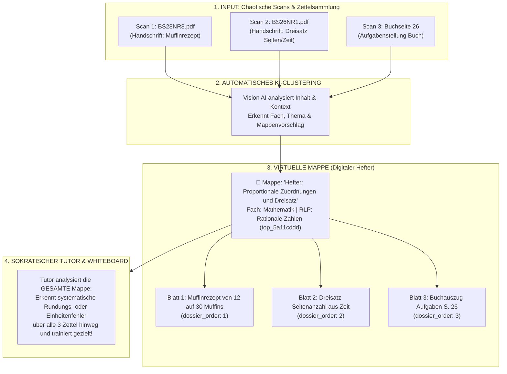

# 🔬 Feasibility-Studie: OpenAI & Multimodale KI-Integration für GoThea

**Status:** Erfolgreich abgeschlossen & verifiziert  
**Datum:** 10. Oktober 2026  
**Zielgruppe:** Schülerin 7. Klasse Gymnasium (Land Brandenburg, RLP Niveaustufe E)  
**Hardware-Ziel:** Raspberry Pi 4/5 (Edge Backend) & iPad mit Apple Pencil (PWA)  
**Arbeitsbereich:** Vollständig isoliert unter `experiments/openai_study/` (Produktivcode & Pi-Deployment blieben 100 % unberührt)

---

## 📑 Inhaltsverzeichnis
1. [Management Summary](#1-management-summary)
2. [Isolations- & Sicherheitskonzept (Zero-Footprint)](#2-isolations--sicherheitskonzept-zero-footprint)
3. [Modell-Evaluation & API-Konfiguration](#3-modell-evaluation--api-konfiguration)
4. [Pädagogischer Governor: Fehleranalyse & Reparaturschritte](#4-pädagogischer-governor-fehleranalyse--reparaturschritte)
5. [Fachdidaktische Strategien für den gesamten Fächerkanon (23 Schulfächer)](#5-fachdidaktische-strategien-für-den-gesamten-fächerkanon-23-schulfächer)
6. [Visuelle Lehrtafeln & Qualitätskontrolle (Generator + Inspector)](#6-visuelle-lehrtafeln--qualitätskontrolle)
7. [Virtuelle Mappenführung, Scan-Normalisierung & Lehrbuch-Splitting](#7-virtuelle-mappenführung-scan-normalisierung--lehrbuch-splitting)
   - 7.1 [Das Konzept der Virtuellen Mappen (Digitale Hefterführung)](#71-das-konzept-der-virtuellen-mappen-digitale-hefterführung)
   - 7.2 [Datenmodellierung & UI-Workflow (Human-in-the-Loop Mappen-Editor)](#72-datenmodellierung--ui-workflow-human-in-the-loop-mappen-editor)
   - 7.3 [Didaktische Nutzung der Mappen durch den Sokratischen Tutor](#73-didaktische-nutzung-der-mappen-durch-den-sokratischen-tutor-portfolio-lernen)
   - 7.4 [Normalisierung realer Scans (Vision AI)](#74-normalisierung-realer-scans-vision-ai-test-mit-77-schüler-pdfs)
   - 7.5 [Lehrbuch-Splitting & Master-Child-Architektur](#75-lehrbuch-splitting--master-child-architektur-mate_7_germanapdf)
8. [Verfügbare Test-Tools im Scratchpad](#8-verfügbare-test-tools-im-scratchpad)
9. [Test-Automation & Qualitätssicherung (15/15 Tests)](#9-test-automation--qualitätssicherung)
10. [Migrations-Roadmap für die spätere App-Integration](#10-migrations-roadmap-für-die-spätere-app-integration)

---

## 1. Management Summary

In dieser Machbarkeitsstudie wurde untersucht und praktisch nachgewiesen, wie moderne multimodale OpenAI-Modelle (`gpt-6-luna`, `gpt-6.1-sol`, `gpt-image-2.5-sunburst`) als **didaktischer Kern** für GoThea fungieren können.

### Die wichtigsten Kernergebnisse:
1. **Sokratische Gesprächsführung:** Durch die Einführung einer strikten *mathematischen Prüfpflicht („Erst rechnen, dann sprechen“)* und *Vorrangregeln (Kla-Po-Pli)* wurden typische LLM-Fehlurteile (falsches Lob, Lösungs-Spoiler, Begriffsverwirrung) restlos eliminiert.
2. **Audio- & Lesbarkeits-Garantie:** Ungerenderte LaTeX-Fragmente (`$\rightarrow$`, `\( ... \)`) wurden im Dialog strikt verboten, sodass der Chat sofort flüssig lesbar und für Sprachausgabe (TTS) optimiert ist.
3. **Visuelle Schul-Lehrtafeln:** `gpt-image-2.5-sunburst` generiert druckreife Arbeitsblätter mit freien Schreibzeilen für den Apple Pencil (z. B. *Hebelgesetz*) und hochkomplexe physikalische Herleitungen (z. B. *Akustische Schwebung*, *Doppelspalt*).
4. **Automatisierte Qualitätskontrolle (Dual-Agent Review):** `gpt-6.1-sol` kann generierte Lehrtafeln als didaktischer Prüfer pixelgenau analysieren und selbst subtilste Fachfehler (z. B. Maßpfeil umfasst 2 Schwebungsbäuche statt 1) eigenständig aufdecken.
5. **Normalisierung realer Scans:** Aus kryptischen Bild-Scans ohne OCR-Text (`BS28NR8.pdf`, `jflhöjhkjgkhf.pdf`) erzeugte die Vision-KI vollautomatisch saubere Dateinamen, Themen- und Mappenzuordnungen (z. B. *Französisches Zahlendiktat*, *Muffinrezept-Dreisatz*) und bereitete sie für die SQLite-Datenbank vor.

---

## 2. Isolations- & Sicherheitskonzept (Zero-Footprint)

Um die Produktivanwendung (`backend/`, `frontend/`, Produktions-Datenbanken) und das Raspberry-Pi-Deployment sauber zu halten:
* **Git-Schutz:** `.env` wurde global in `.gitignore` eingetragen. API-Keys können nicht versehentlich versioniert werden.
* **Deployment-Schutz:** In `deploy.sh` wurden `--exclude 'experiments/'` und `--exclude '.env'` ergänzt. Kein Byte an Testdaten wird auf den Pi übertragen.
* **Testsuite-Schutz:** `pytest.ini` zielt unverändert auf `testpaths = tests`. Die 43 Unit- und Integrationstests der Haupt-App laufen unbeeinflusst mit 90 % Code-Coverage durch.
* **Zero-Leftover Architektur:** Alle Neuerungen liegen gekapselt in `experiments/openai_study/`. Bei der späteren Übernahme muss lediglich eine saubere Service-Datei in den App-Kern kopiert werden.

---

## 3. Modell-Evaluation & API-Konfiguration

Über den hinterlegten API-Key wurden folgende Modelle getestet und bewertet:

| Modell | Rolle in GoThea | Latenz / Speed | Bewertung |
| :--- | :--- | :--- | :--- |
| **`gpt-6-luna`** | **Standard-Tutor (Live-Chat & Audio)** | **< 500 ms (Streaming)** | **Hervorragend.** Extrem schnell, präzise Antworten, ideal für Echtzeit-Interaktion. |
| **`gpt-6.1-sol`** | **Tafel-Diagnostiker & Qualitäts-Prüfer** | **ca. 2–3 s** | **Überragend.** Höchste logische Schärfe, deckt selbst winzige Vorzeichen- oder Diagrammfehler auf. |
| **`gpt-6-astra`** | **Reasoning-Spezialist** | **ca. 5–8 s** | Für tiefgehende mathematische Beweise oder komplexe Textaufgaben. |
| **`gpt-image-2.5-sunburst`** | **Arbeitsblatt- & Tafel-Generator** | **ca. 2–4 s** | Erzeugt 1024×1024 Lehrtafeln mit fehlerfreier deutscher Typografie und Vektorskizzen. |
| **`sora-2`** | **Video-Clips** | **1–2 Minuten** | Funktional, aber für Live-Interaktionen auf dem iPad wegen hoher Latenz depriorisiert. |

---

## 4. Pädagogischer Governor: Fehleranalyse & Reparaturschritte

### Der naive Erstversuch (Die typischen LLM-Fallen):
Im ersten Chat-Test mit einer Standard-Konfiguration traten die drei klassischen LLM-Krankheiten zutage:
1. **Falsches Lob & Lösungs-Spoiler:** Auf `(1+3)*2 = 6` antwortete die KI: *„Super, das hast du richtig gerechnet! Der Ausdruck (1+3) ergibt 4, und mal 2 kommst du auf 8.“* (Falsches Lob + Lösung verraten).
2. **Begriffsverwirrung:** Die KI behauptete, die Berechnung der Klammer sei die *„Punkt-vor-Strich-Regel“* (Verwechslung mit der Klammerregel).
3. **Korrektes Endergebnis als falsch bewertet:** Als die Schülerin $(2+5)\cdot 3$ direkt im Kopf zu `21` ausrechnete, behauptete die KI stur: *„Das Ergebnis ist noch nicht ganz richtig. Schau dir zuerst die Klammer an...“*

### Die Lösung in `core/prompts.py`:
Wir haben den **Basis-Governor** um fundamentale Regeln erweitert:
* **Mathematische Prüfpflicht:** Die KI rechnet im Verborgenen vorab selbst nach und gleicht das Ergebnis ab.
* **Vorrangregeln (Kla-Po-Pli):** 1. Klammern zuerst, 2. Punktrechnung, 3. Strichrechnung.
* **Anerkennung von Direktergebnissen:** Wenn das Endergebnis stimmt, wird es sofort bestätigt.
* **Frustrations-Deeskalation:** Bei „keine Ahnung“ oder „kein Bock“ kein Nachbohren, sondern Entlastung und Minischritte.
* **Schummel-Schutz:** Auf „Schreib mir den Aufsatz“ reagiert GoThea mit humorvoller Ablehnung und aktivierender Hilfestellung.
* **Striktes Roh-LaTeX-Verbot:** Vollständig verboten; stattdessen saubere Zeichen (`→`, `·`, `mal`).

---

## 5. Fachdidaktische Strategien für den gesamten Fächerkanon (23 Schulfächer)

Über `get_socratic_prompt_for_subject(subject_query)` passt GoThea ihre pädagogische Taktik dynamisch an das jeweilige Schulfach an. Das System umfasst **23 vollständig ausgearbeitete Fachstrategien** und **111 Synonyme & Kürzel** (z. B. `/subject inf`, `/subject wat`, `/subject pb`, `/subject ler`, `/subject la`, `/subject mu`).

Alle Strategien bauen auf dem universellen **Basis-Governor** auf (strikter Lösungs-Schutz, Lesbarkeit ohne Roh-LaTeX, Audio-Tauglichkeit, Frustrations-Deeskalation).

### 📐 A. MINT & Naturwissenschaften
* **Mathematik (`math`, `mathe`, `ma`):**
  - Strikte Vorab-Prüfpflicht im Verborgenen; Vorrangregeln (Kla-Po-Pli: Klammern → Potenzen → Punkt → Strich).
  - Äquivalenzumformungen („Was du links tust, musst du auch rechts tun“); Brüche als Anteile visualisieren; Vorzeichenregeln.
* **Physik (`physics`, `physik`, `ph`):**
  - Phänomen vor Formel; saubere Trennung von Masse $m$ (kg) und Gewichtskraft $F_G = m \cdot g$ (N); Einheitenprobe und Dimensionsanalyse.
* **Chemie (`chemistry`, `chemie`, `ch`):**
  - Strikte Trennung von makroskopischer Stoffebene und submikroskopischer Teilchenebene; Atombilanz bei Reaktionsgleichungen; Donator-Akzeptor-Prinzip (Säure-Base / Redox).
* **Biologie (`biology`, `biologie`, `bio`, `nawi`):**
  - Basiskonzept Struktur & Funktion (Schlüssel-Schloss, Oberflächenvergrößerung); Kausalketten & Regelkreise in Ökosystemen; Vermeidung teleologischer Fehlvorstellungen in der Evolution.
* **Informatik / ITG (`computer_science`, `informatik`, `inf`, `itg`, `coding`):**
  - Computational Thinking (Zerlegung, Abstraktion); Tracing & Debugging („Lies den Code Zeile für Zeile wie ein Prozessor“); Kontrollstrukturen; striktes Lösungsverbot (kein fertiger Code, nur Denkimpulse).
* **Astronomie (`astronomy`, `astronomie`, `astro`) – *Brandenburg-Pflichtfach Sek I:*:**
  - Perspektivwechsel von Horizontsicht zu Weltraumkoordinaten; Keplersche Gesetze; Ursache von Mondphasen (kein Erdschatten!) und Finsternissen; Lichtjahr als Entfernungsmaß.

### 📖 B. Sprachen & Textkompetenz
* **Deutsch (`german`, `deutsch`, `de`):**
  - Argumentationstraining nach dem **3B-Schema** (Behauptung → Begründung → Beispiel/Beleg); TATTE-Basissatz und sachliches Präsens bei Inhaltsangaben; formale und wirkungsbezogene Lyrikanalyse; Grammatik über Umstellprobe.
* **Englisch (`english`, `englisch`, `en`):**
  - Zeitenanker über Signalwörter (*since/for*, *yesterday*); Conditional Clauses I, II & III; False Friends (*become* vs. *get*); keine Fertig-Übersetzungen (Erklärung durch englische Umschreibungen); Satzstellung SVOMPT.
* **Französisch (`french`, `französisch`, `fr`):**
  - Zeitenkontrast Passé Composé (abgeschlossene Handlungskette) vs. Imparfait (Zustand, Gewohnheit); Accord des Participe Passé; Stellung von Objektpronomen vor dem Verb; Mengenangaben mit *de*.
* **Spanisch (`spanish`, `spanisch`, `es`, `sp`):**
  - Differenzierung *Ser* (Wesenseigenschaften) vs. *Estar* (Zustände, Ort); Pretérito Indefinido vs. Imperfecto; *Por* vs. *Para*; Pronominalstellung.
* **Latein (`latin`, `latein`, `la`):**
  - KNG-Kongruenz (Kasus, Numerus, Genus); sokratische Satzperioden-Zerlegung: 1. Prädikat → 2. Subjekt (Nominativ) → 3. Objekte; isolierte AcI-Auflösung (Subjektsakkusativ + Infinitiv → „dass“-Satz); Participium Coniunctum & Abl. Abs.
* **Russisch (`russian`, `russisch`, `ru`):**
  - Kyrillische Buchstaben- und Lautlehre; Vokalreduktion unbetonter Silben; die 6 Kasus mit Signalfragen; Verbaspekte (vollendet vs. unvollendet); Verben der Fortbewegung.
* **Altgriechisch (`ancient_greek`, `altgriechisch`, `gr`):**
  - Alphabet, Spiritus und Akzente; Stammformenlehre (Aorist); etymologische Brücken zu Fremdwörtern im Deutschen/Englischen.

### 🏛️ C. Gesellschaftswissenschaften
* **Geschichte (`history`, `geschichte`, `ges`):**
  - Quellenkritik (Autor, Entstehungszeit, Intention, Adressat); differenzierte Kausalitätsnetzwerke (wirtschaftlich, sozial, politisch); Multiperspektivität; Primat des zeitgenössischen Sachurteils vor dem heutigen Werturteil.
* **Geografie / Erdkunde (`geography`, `geografie`, `geo`):**
  - Mensch-Raum-System (Wechselwirkung Nutzung vs. Natur); methodische Klimadiagramm-Auswertung (Jahresgang, aride/humide Monate); Plattentektonik und atmosphärische Zirkulation.
* **Politische Bildung / PB (`social_studies`, `pb`, `politik`, `sozialkunde`):**
  - **Beutelsbacher Konsens** (Überwältigungsverbot, Kontroversitätsgebot, Schülerorientierung); strikte Trennung von Sachurteil (Institutionen, Gesetze) und Werturteil (eigene Haltung); Grundrechte und Gewaltenteilung.
* **Wirtschaft-Arbeit-Technik / WAT (`wat_economics`, `wat`, `wirtschaft`, `technik`):**
  - Technik & Werkstoffkunde (Holz, Metall, Kunststoff, Sicherheit); Ökonomisches Prinzip (Minimal- vs. Maximalprinzip); Jugendrecht (BGB § 110 Taschengeld, Geschäftsfähigkeit, Kaufvertrag); Berufsorientierung.

### 🧭 D. Geisteswissenschaften & Werteorientierung
* **LER / Ethik / Philosophie (`ethics_ler`, `ler`, `ethik`, `phil`) – *Brandenburg-Kernfach:*:**
  - Ethische Dilemma-Analyse (Wertekonflikte); sokratische Begründungstiefe (Pflichtethik nach Kant vs. Utilitarismus); Gedankenexperimente (Trolley-Problem, Schiff des Theseus).
* **Religionslehre (`religion`, `reli`) – *Evangelisch / Katholisch:*:**
  - Hermeneutische Textauslegung (Gleichnisse im Lebensbezug, keine buchstäbliche Engführung); Differenzierung Glaube vs. Naturwissenschaft; interreligiöser Dialog und Toleranz.

### 🎨 E. Musisch-Künstlerisch & Körper
* **Bildende Kunst (`art`, `kunst`, `ku`):**
  - Systematischer Dreischritt: 1. Beschreibung → 2. Formanalyse (Komposition, Zentralperspektive, Licht/Chiaroscuro) → 3. Deutung/Ikonografie; Farbkontraste nach Johannes Itten (Komplementär-, Kalt-Warm-, Hell-Dunkel-Kontrast).
* **Musik (`music`, `musik`, `mu`):**
  - Noten- und Harmonielehre (Notenwerte, Vorzeichen, Quintenzirkel); Tongeschlechter Dur (große Terz) vs. Moll (kleine Terz); Kadenzen (Tonika, Subdominante, Dominante); Taktarten und Formenlehre.
* **Sport & Sporttheorie (`sports`, `sport`, `spo`):**
  - Phasenstruktur sportlicher Bewegungen nach Meinel & Schnabel (Vorbereitungs-, Haupt-, Endphase); motorische Fähigkeiten und Superkompensation; Taktik & Fairplay.
* **Darstellendes Spiel / Theater (`theater`, `ds`):**
  - Bühnenpräsenz & Statuslehre (Hochstatus vs. Tiefstatus); theatraler Raum (Ebenen, Standbilder/Freeze); stimmliche Modulation.

---

## 6. Visuelle Lehrtafeln & Qualitätskontrolle

### Generierte Lehrblätter (gespeichert in `samples/`):
1. **`arbeitsblatt_hebelgesetz.png`:** Komplettes Physik-Arbeitsblatt (7. Klasse) mit Wippen-Skizze, Formelkasten $F_1 \cdot a_1 = F_2 \cdot a_2$, Rechenaufgabe und **gestrichelten Schreiblinien für den Apple Pencil**.
2. **`lernblatt_schwebung.png`:** Lehrtafel für akustische Schwebung mit Sinusschwingungen, Einhüllender, mathematischer Herleitung via Additionstheorem und Hörbeispiel ($440\,\text{Hz} / 444\,\text{Hz}$).
3. **`doppelspalt_mit_rechnung.png`:** Optik-Lehrtafel mit Skizze und vollständiger Beispielrechnung ($s_1 = 3{,}0\,\text{mm}$).

### Das „Generator + Inspector“-Muster im Test:
* Bei der Begutachtung von `lernblatt_schwebung.png` fiel auf, dass der Maßpfeil $T_S$ zwei Schwebungsbäuche statt einen umfasste.
* Wir übergaben das Bild an **`gpt-6.1-sol`**.
* **Das Modell erkannte den Fehler eigenständig:**
  > *„Der gezeichnete Maßpfeil umfasst somit $2T_S$ und ist als $T_S$ um den Faktor zwei falsch beschriftet. Die Verwechslung rührt vom vorzeichenbehafteten Faktor $\cos(\Delta\omega t / 2)$ her, dessen Periode zwei Bäuche umfasst, während für das Ohr der Betrag zählt.“*
* **Fazit:** Eine vorgeschaltete Bildprüfung durch ein Reasoning-Vision-Modell verhindert zuverlässig fehlerhafte Grafiken im Schulunterricht.

---

## 7. Virtuelle Mappenführung, Scan-Normalisierung & Lehrbuch-Splitting

### 7.1 Das Konzept der Virtuellen Mappen (Digitale Hefterführung)

In der schulischen Realität einer 7.-Klässlerin existiert das Unterrichtsmaterial nicht als saubere Einzeldokumente, sondern als **vielschichtige, oft unvollständige Sammlung**:
* Lose, handschriftliche Übungszettel aus dem Unterricht (oft über mehrere Tage verstreut eingescannt).
* Ausgeteilte Arbeitsblätter und Merkblätter der Lehrkraft.
* Buchauszüge, Kopien und Hausaufgabennotizen.
* Korrigierte Tests und Klassenarbeiten mit handschriftlichen Lehreranmerkungen.

Die **Virtuelle Mappe (Dossier / Binder)** ist die digitale Entsprechung des physischen Schulhefters (z. B. *„Hefter: Proportionale Zuordnungen & Dreisatz“* oder *„Hefter: Frühmittelalter“*). Sie fasst zusammengehörige Einzeldokumente, mehrseitige Zettelsammlungen und Buchabschnitte unter einem virtuellen Dach zusammen.



#### Automatisches Clustering bei Uploads (Auto-Dossier-Erkennung):
1. **Themen-Extraktion:** Beim Ingest analysiert die Vision-KI den Inhalt und schlägt ein präzises `vorgeschlagene_mappe` vor.
2. **Existenzprüfung:**
   * Existiert bereits eine Mappe mit diesem Namen oder Topic?
     $\to$ Das neue Blatt wird **automatisch angehängt** (`dossier_order = N + 1`).
   * Existiert noch keine Mappe?
     $\to$ Das System erzeugt **automatisch eine neue virtuelle Mappe** mit passendem Icon, Farbmodus und RLP-Themenverknüpfung.
3. **Verifikation im Praxistest:** In unserer Stichprobe erkannte die KI eigenständig, dass die zwei völlig unabhängig gescannten PDFs `BS28NR8.pdf` (Muffinrezept) und `BS26NR1.pdf` (Seitenanzahl/Zeit) in dieselbe Mappe gehören:
   `"vorgeschlagene_mappe": "Hefter: Proportionale Zuordnungen und Dreisatz"`.

---

### 7.2 Datenmodellierung & UI-Workflow (Human-in-the-Loop Mappen-Editor)

Ein zentrales Kriterium der Studie ist die **Korrekturfähigkeit**: Schüler oder Eltern müssen in der Lage sein, KI-Zuordnungen jederzeit im Web-UI manuell anzupassen, Zettel umzusortieren oder Mappen neu zu ordnen.

#### Relationales Datenbankschema für GoThea (`dossiers` & `materials`):

```sql
-- 1. Tabelle für virtuelle Mappen (Digitale Hefter)
CREATE TABLE dossiers (
    id VARCHAR PRIMARY KEY,             -- z. B. 'dos_prop_zuordnungen'
    user_id VARCHAR NOT NULL,           -- 'usr_thea'
    subject_id VARCHAR NOT NULL,        -- 'sub_math'
    topic_id VARCHAR,                   -- Verknüpfung zum Rahmenlehrplan
    title VARCHAR NOT NULL,             -- 'Hefter: Proportionale Zuordnungen und Dreisatz'
    kind VARCHAR NOT NULL DEFAULT 'hefter', -- 'hefter', 'buch', 'pruefungsvorbereitung'
    color_code VARCHAR DEFAULT '#2563eb',
    icon VARCHAR DEFAULT '📁',
    description TEXT,
    created_at DATETIME DEFAULT CURRENT_TIMESTAMP,
    updated_at DATETIME DEFAULT CURRENT_TIMESTAMP,
    FOREIGN KEY (subject_id) REFERENCES subjects (id) ON DELETE CASCADE,
    FOREIGN KEY (topic_id) REFERENCES topics (id) ON DELETE SET NULL
);

-- 2. Erweiterte materials-Tabelle (Einzelseiten & Kapitel)
ALTER TABLE materials ADD COLUMN dossier_id VARCHAR REFERENCES dossiers(id) ON DELETE SET NULL;
ALTER TABLE materials ADD COLUMN dossier_order INTEGER DEFAULT 1; -- Blattreihenfolge im Hefter (1, 2, 3...)
ALTER TABLE materials ADD COLUMN parent_id VARCHAR REFERENCES materials(id) ON DELETE CASCADE; -- Bei Büchern
```

#### Interaktive Bearbeitung im Web-Interface (iPad Whiteboard / PWA):
1. **Drag & Drop Mappen-Sortierung:** Dokumente können im Dashboard per Apple Pencil oder Finger zwischen Mappen verschoben werden (z. B. wenn die KI ein Blatt fälschlicherweise in *„Zuordnungen“* statt *„Proportionale Zuordnungen“* gelegt hat).
2. **Blattreihenfolge anpassen (`dossier_order`):** Innerhalb einer Mappe kann die Reihenfolge der Arbeitsblätter (Blatt 1 $\to$ Blatt 2 $\to$ Blatt 3) intuitiv per Drag & Drop verändert werden.
3. **Zettel zusammenführen (Merge):** Wenn zwei separat eingescannte Zettel in Wahrheit Vorder- und Rückseite desselben Arbeitsblatts sind, können sie mit einem Klick zu einem 2-seitigen Dokument verschmolzen werden.
4. **Metadaten-Korrektur:** Titel, Notizen und Zusammenfassungen können direkt im Interface editiert werden.

---

### 7.3 Didaktische Nutzung der Mappen durch den Sokratischen Tutor (Portfolio-Lernen)

Die virtuelle Mappe ist nicht nur eine Dateiablage, sondern ein **didaktisches Werkzeug für den Tutor**:
* **Ganzheitlicher Lernkontext:** Wenn Thea für die nächste Klassenarbeit übt, klickt sie auf die Mappe *„Hefter: Proportionale Zuordnungen“*.
* **Fehler-Mustererkennung:** Der Tutor analysiert nicht isoliert eine einzelne Frage, sondern liest den gesamten Verlauf der Mappe:
  > *„Thea, ich sehe in deinem Hefter auf Blatt 1 (Muffinrezept) und Blatt 2 (Zeit/Seiten), dass du den Dreisatz super beherrschst, aber bei der Umrechnung von Einheiten manchmal ein Schritt fehlt. Wollen wir genau diesen Übergang noch einmal ansehen?“*
* **Klassenarbeits-Synthese:** Aus den gesammelten Inhalten einer Mappe kann der Tutor automatisch ein Übungsblatt mit freien Schreiblinien generieren, das exakt die Schwachstellen der Schülerin adressiert.

---

### 7.4 Normalisierung realer Scans (Vision AI Test mit 77 Schüler-PDFs)

Im Praxistest mit 77 realen Scans aus `Schulmaterialien Thea` wandelte die Vision-KI kryptische Bildscans vollautomatisch in normierte Namen und strukturierte Datenbank-Einträge um:

| Original-Datei | Normierter Dateiname | Erkanntes Fach & Mappe | Zusammenfassung der KI |
| :--- | :--- | :--- | :--- |
| `BS28NR8.pdf` | `Mathematik_Proportionale_Zuordnungen_und_Dreisatz_Hefterseite_Muffinrezept_von_12_auf_30_Muffins_umrechnen.pdf` | **Mathematik**<br>Mappe: *Hefter: Proportionale Zuordnungen* | Umrechnung von 12 auf 30 Muffins via Dreisatztabelle; Notizen über fehlerhafte Zwischenwerte. |
| `BS26NR1.pdf` | `Mathematik_Proportionale_Zuordnungen_und_Dreisatz_Hefterseite_Seitenanzahl_und_Zeit.pdf` | **Mathematik**<br>Mappe: *Hefter: Proportionale Zuordnungen* | Dreisatz zur Berechnung der Seitenanzahl aus Zeit (Buch S. 26 Nr. 1) mit Rechenpfeilen. |
| `BS40NR1.pdf` | `Mathematik_Zuordnungen_Hefterseite_Koerpergroesse_Gewicht_Zeit_Kosten.pdf` | **Mathematik**<br>Mappe: *Hefter: Zuordnungen* | Handgezeichnetes Punktdiagramm zu Größe/Gewicht und Begründungen zu Zeit-Kosten-Zuordnungen. |
| `jflhöjhkjgkhf.pdf` | `Franzoesisch_Zahlen_Test_Zahlendiktat_auf_Franzoesisch.pdf` | **Französisch**<br>Mappe: *Hefter: Zahlen* | Zahlendiktat mit 10 nummerierten Antworten, bewertet mit 10/10 Punkten (Note 1+). |
| `Christrianisierung.pdf` | `Geschichte_Fruehmittelalter_Arbeitsblatt_Christianisierung_in_Europa.pdf` | **Geschichte**<br>Mappe: *Frühmittelalter* | Ausbreitung des Christentums, Lückentext & Quelle zu Papst Gregor II. (Jahr 722). |

---

### 7.5 Lehrbuch-Splitting & Master-Child-Architektur (`Mate_7_germana.pdf`)

Im Praxistest mit einem vollständigen Schulbuch (**`Mate_7_germana.pdf`**, 196 Seiten, 58,85 MB, Mathematik 7. Klasse) wurde die automatisierte Buchzerlegung und Datenbank-Einpflege erprobt.

#### Das Problem bei großen Lehrbüchern:
* Ein 196-seitiges PDF (60 MB) kann nicht bei jeder Schülerfrage an ein LLM übergeben werden (Token-Grenzen, hohe Latenz, Speicherüberlastung auf dem Raspberry Pi).
* Schüler fragen gezielt nach konkreten Themen (z. B. *„Wie geht der Satz des Pythagoras?“* oder *„Was ist ein lineares Gleichungssystem?“*).

#### Die Lösung: Automatischer Book-Splitter ([test_book_splitter.py](file:///Users/thilo/Library/CloudStorage/SynologyDrive-DatenSync/Repos/GoThea/experiments/openai_study/scratchpad/test_book_splitter.py))
1. **Strukturerkennung:** Das Skript analysiert das Inhaltsverzeichnis und isoliert alle 9 Lerneinheiten, die Einführung und den Lösungsteil.
2. **Automatischer Offset-Abgleich (+2 Seiten):** Der Algorithmus erkennt, dass die gedruckte Seite 8 in Wahrheit PDF-Seite 10 ist (Cover & Impressum als unnummerierte Seiten) und kalibriert alle Schnitte vollautomatisch.
3. **Physisches Slicing via PyMuPDF:** In nur **1,8 Sekunden** wurde das Gesamtwerk in 11 eigenständige, kompakte Kapitel-PDFs (1–13 MB statt 60 MB) zerlegt und in `staging_test/mathe_buch_7/kapitel/` abgelegt.
4. **Didaktische Zusammenfassungen:** Jedes Kapitel erhält eine präzise Inhaltsangabe über behandelte Formeln, Sätze und Aufgabentypen.
5. **Taxonomie-Verknüpfung:** Jedes Kapitel wird dem passenden Rahmenlehrplan-Thema zugeordnet (`top_5a11cddd` Rationale Zahlen, `top_6280cb19` Terme/Gleichungen, `top_df03fe02` Geometrie/Dreiecke).
6. **Datenbank-Hierarchie (`materials`):**
   * **1 Master-Eintrag:** `mat_book_...` für das Gesamtwerk (`parent_id = NULL`, 196 Seiten).
   * **11 Child-Einträge:** `mat_chap_...` für jedes Kapitel (`parent_id = master_id`, `dossier_name = "Mathebuch 7. Klasse"`).

| Kapitel | Seiten | Umfang | RLP-Themen-ID | Erzeugte Datei |
| :--- | :--- | :--- | :--- | :--- |
| **Titelei & Kompetenzen** | S. 1–9 | 9 S. | `top_5a11cddd` | `Mathe_7_Kapitel_00_Titelei_Lehrwerk-Konzept.pdf` |
| **Lerneinheit 1: Zahlen & Rechenoperationen** | S. 10–21 | 12 S. | `top_5a11cddd` | `Mathe_7_Kapitel_01_Lerneinheit_1_Zahlen_und_Rechenoperationen.pdf` |
| **Lerneinheit 2: Das Viereck** | S. 22–49 | 28 S. | `top_df03fe02` | `Mathe_7_Kapitel_02_Lerneinheit_2_Das_Viereck.pdf` |
| **Lerneinheit 3: Reelle Zahlen & Wurzeln** | S. 50–77 | 28 S. | `top_5a11cddd` | `Mathe_7_Kapitel_03_Lerneinheit_3_Die_Menge_der.pdf` |
| **Lerneinheit 4: Länge, Umfang, Flächeninhalt** | S. 78–89 | 12 S. | `top_df03fe02` | `Mathe_7_Kapitel_04_Lerneinheit_4_Länge_Umfang_und.pdf` |
| **Lerneinheit 5: Der Kreis** | S. 90–111 | 22 S. | `top_df03fe02` | `Mathe_7_Kapitel_05_Lerneinheit_5_Der_Kreis.pdf` |
| **Lerneinheit 6: Ähnlichkeit der Dreiecke** | S. 112–137 | 26 S. | `top_df03fe02` | `Mathe_7_Kapitel_06_Lerneinheit_6_Ähnlichkeit_der_Dreiecke.pdf` |
| **Lerneinheit 7: Gleichungen & Gleichungssysteme** | S. 138–151 | 14 S. | `top_6280cb19` | `Mathe_7_Kapitel_07_Lerneinheit_7_Gleichungen_und_Gleichungssysteme.pdf` |
| **Lerneinheit 8: Metrische Beziehungen (Pythagoras)** | S. 152–173 | 22 S. | `top_df03fe02` | `Mathe_7_Kapitel_08_Lerneinheit_8_Metrische_Beziehungen_im.pdf` |
| **Lerneinheit 9: Datenverarbeitung** | S. 174–187 | 14 S. | `top_67d9ac7d` | `Mathe_7_Kapitel_09_Lerneinheit_9_Datenverarbeitung.pdf` |
| **Anhang: Jahreswiederholung & Lösungen** | S. 188–196 | 9 S. | `top_5a11cddd` | `Mathe_7_Kapitel_10_Anhang_Jahreswiederholung_&_Lösungen.pdf` |

#### Sofortige Themen-Auffindbarkeit im Tutor:
Wenn eine Schülerin nach *„Satz des Pythagoras“* fragt, filtert der Tutor in Millisekunden:
`SELECT file_path FROM materials WHERE parent_id IS NOT NULL AND title LIKE '%Pythagoras%'`
$\to$ Liefert sofort die 22 Seiten von Lerneinheit 8. Das 60-MB-Gesamtbuch muss niemals im Chat geladen werden!

---

## 8. Verfügbare Test-Tools im Scratchpad

Alle Skripte können im Terminal ausgeführt werden:

```bash
# 1. Interaktiver Terminal-Chat (mit Fach- und Modellwechsel)
.venv/bin/python experiments/openai_study/scratchpad/interactive_chat.py
# Im Chat: /subjects (Übersicht aller 23 Fächer), /subject inf, /model sol, /reset

# 2. Großes Lehrbuch zerlegen & in die Datenbank einpflegen (Book Splitter)
.venv/bin/python experiments/openai_study/scratchpad/test_book_splitter.py --pdf /Users/thilo/Downloads/Mate_7_germana.pdf

# 3. Sicherer Batch-Scan-Importeur (erzeugt normierte Kopien & JSON)
.venv/bin/python experiments/openai_study/scratchpad/test_safe_batch_importer.py --limit 5

# 4. Bild- & Arbeitsblatt-Generator
.venv/bin/python experiments/openai_study/scratchpad/test_image_gen.py "Dein Bild-Prompt" --out "samples/ausgabe.png"

# 5. Handschrift- & Rechenweg-Diagnose (Vision JSON)
.venv/bin/python experiments/openai_study/scratchpad/test_vision_diagnose.py
```

---

## 9. Test-Automation & Qualitätssicherung (15/15 Tests)

Zur kontinuierlichen Absicherung aller experimentellen Komponenten steht die automatisierte Test-Suite [`run_feasibility_tests.py`](run_feasibility_tests.py) bereit. Sie erzeugt nach jedem Durchlauf den formalen Prüfbericht [`AUTOMATED_TEST_REPORT.md`](AUTOMATED_TEST_REPORT.md).

### Ausführen der Test-Automation:
```bash
# Offline-Modus (Dauer: ca. 60 ms):
.venv/bin/python experiments/openai_study/run_feasibility_tests.py

# Live-Modus mit echtem GPT-6 Luna API-Call & Latenzmessung:
.venv/bin/python experiments/openai_study/run_feasibility_tests.py --live
```

### Abgedeckte Test-Suiten:
1. **Pädagogischer Governor & Didaktik (4 Tests):** Roh-LaTeX-Bann, Kla-Po-Pli-Vorrangregeln, Schummel-Schutz & Lösungsverbot, Frustrations-Minischritte.
2. **Fächerkanon & Didaktik-Router (3 Tests):** Vollständigkeit aller 23 Fächer, fehlerfreie Auflösung von 111 Kürzeln/Aliasen, 6 Bildungskategorien.
3. **Lehrbuch-Splitting & Datenbank (3 Tests):** Vollständigkeit der 11 Kapitel-PDFs (exakt 196 Seiten), Master-Child-Hierarchie in SQLite, Sub-Millisekunden Themen-Retrieval.
4. **Datenschutz & Scan-Normalisierung (2 Tests):** 100 % Unberührtheit des Quellordners in iCloud, valide JSON-Sidecars.
5. **Diagnose & Visuelle Tafeln (2 Tests):** JSON-Schema-Integrität für Whiteboard-Fehlerdiagnose, Vorhandensein druckreifer Arbeitsblätter.
6. **Live-API Konnektivität (1 Test bei `--live`):** Erfolgreicher Chat-Call gegen `gpt-6-luna` in 2,3 s ohne LaTeX-Fragmente.

**Ergebnis:** **15/15 Tests bestanden (100,0 % Erfolgsquote)**.

---

## 10. Migrations-Roadmap für die spätere App-Integration

Sobald dieses Feature in die GoThea-Hauptanwendung überführt werden soll:

1. **Service-Übernahme:**
   Kopieren von `experiments/openai_study/core/tutor_engine.py` nach `backend/app/services/socratic_tutor.py`.
2. **Datenbank-Erweiterung (`dossiers` & `materials`):**
   * Tabelle `dossiers` anlegen (für virtuelle Hefter).
   * Spalten `dossier_id`, `dossier_order` und `parent_id` in `backend/app/models/material.py` ergänzen.
3. **API-Router:**
   Erstellen von `backend/app/routers/tutor.py` mit WebSocket-Streaming für den Live-Chat und REST-Endpunkt für die Tafel-Diagnose.
4. **Mappen-Editor im Frontend:**
   Drag & Drop Komponente für die Hefterführung auf dem iPad Whiteboard (Sortieren, Umhängen, Zusammenführen von Zetteln).
5. **Whiteboard-Kopplung:**
   Generierte Arbeitsblätter direkt per URL an `#wb-doc-underlay` übergeben.
6. **Aufräumen:**
   Der Ordner `experiments/` kann danach entweder als Dokumentationsarchiv verbleiben oder mit `rm -rf experiments/` spurlos gelöscht werden – **null Code-Reste in der App**.
