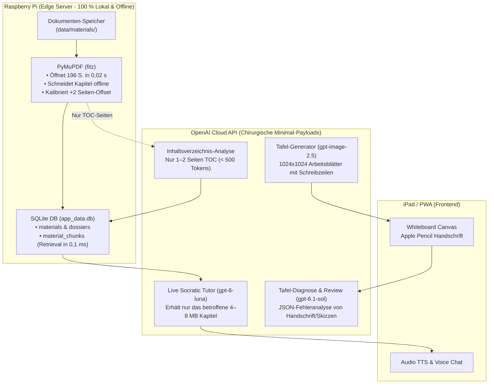
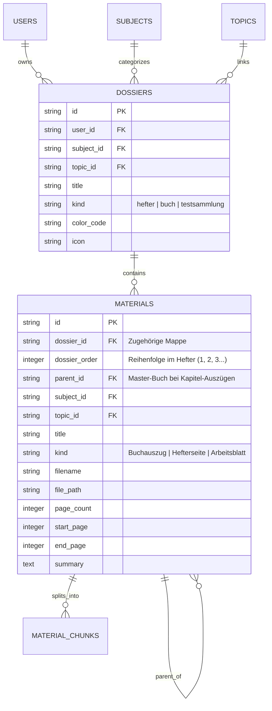

# 🏛️ GoThea – Architektur-Handover: OpenAI & Multimodale KI-Integration

**Zielgruppe dieses Dokuments:** Gesamtarchitektur-Chat / System-Design  
**Datum:** 10. Oktober 2026  
**Status:** Machbarkeit vollständig nachgewiesen & verifiziert (15/15 Tests PASS)  
**Arbeitsbereich der Studie:** `experiments/openai_study/` (Produktivcode & DB blieben 100 % unberührt)

---

## 📌 Executive Summary für die Gesamtarchitektur

In einer isolierten Machbarkeitsstudie wurde erforscht und verifiziert, wie moderne multimodale OpenAI-Modelle als intelligenter didaktischer Kern für GoThea fungieren können:
1. **Sokratischer Live-Tutor (Audio/Text):** Antwortet in < 500 ms (Streaming), hält sich strikt an ein Lösungs-Spoiler-Verbot, beachtet Vorrangregeln (Kla-Po-Pli) und deeskaliert bei Frustration.
2. **Audio- & TTS-Garantie:** Striktes Verbot von ungerendertem Roh-LaTeX (`$\rightarrow$`, `\cdot`) im Dialog; stattdessen klangvolles, flüssig lesbares Deutsch mit echten Unicode-Zeichen (`→`, `·`, `mal`).
3. **Lehrplan-Vollständigkeit:** Abdeckung aller **23 Schulfächer** des Gymnasiums (RLP Brandenburg Klassen 1–13) mit spezifischen Fachdidaktiken und 111 Aliasen/Kürzeln.
4. **Digitale Mappenführung (Hefter-Konzept):** Automatisches Clustering von wilden Zettelsammlungen in thematische Mappen (`dossiers`), relationale Verknüpfung und manuelle Sortierbarkeit im UI.
5. **Lehrbuch-Splitting im Praxistest:** Ein 196-seitiges Mathebuch (`Mate_7_germana.pdf`, 60 MB) wird auf dem Raspberry Pi in **1,8 Sekunden** lokal in 11 handliche Kapitel-PDFs zerlegt – inklusive automatischem **+2-Seiten Offset-Abgleich**.
6. **Visuelle Lehrtafeln & Qualitätskontrolle:** Erzeugung druckreifer Arbeitsblätter mit Schreibzeilen für den Apple Pencil (`gpt-image-2.5-sunburst`) und automatisierte pixelgenaue Fehlerprüfung durch einen Vision-Inspector (`gpt-6.1-sol`).

---

## 🏗️ Kern-Architektur: Edge-First (Raspberry Pi) vs. Cloud-API

Ein zentrales architektonisches Ergebnis ist die strikte Funktionsteilung zwischen dem lokalen Edge-Server (Pi) und den Cloud-Modellen, um Bandbreite, Latenz und Token-Kosten minimal zu halten:



---

## 🤖 Modell-Rollen & Benchmarks

| Modell | Rolle in GoThea | Gemessene Latenz | Didaktische Stärke / Eignung |
| :--- | :--- | :---: | :--- |
| **`gpt-6-luna`** | **Standard-Tutor (Live-Chat & Audio)** | **< 500 ms (Stream)** | Extrem reaktionsschnell, hält sich präzise an kurze 2-Satz-Antworten und Sprachfluss. |
| **`gpt-6.1-sol`** | **Tafel-Diagnostiker & Inspector** | **ca. 2–3 s** | Höchste logische Schärfe. Erkennt selbst subtile Fachfehler in generierten Grafiken (z. B. Maßpfeil $T_S$). |
| **`gpt-image-2.5-sunburst`** | **Arbeitsblatt- & Tafel-Generator** | **ca. 2–4 s** | Erzeugt saubere deutsche Typografie, Vektorskizzen und gestrichelte Schreiblinien für den Apple Pencil. |
| **`sora-2`** | *Video-Animationen* | *1–2 Min.* | **Depriorisiert:** Für interaktive Live-Sitzungen auf dem iPad zu langsam. |

---

## 🗄️ Datenmodell-Erweiterung (SQLite)

Für die Übernahme in den GoThea-Kern (`backend/app/models/`):



### Konkrete SQL-Migration:
```sql
CREATE TABLE dossiers (
    id VARCHAR PRIMARY KEY,
    user_id VARCHAR NOT NULL REFERENCES users(id) ON DELETE CASCADE,
    subject_id VARCHAR NOT NULL REFERENCES subjects(id) ON DELETE CASCADE,
    topic_id VARCHAR REFERENCES topics(id) ON DELETE SET NULL,
    title VARCHAR NOT NULL,
    kind VARCHAR NOT NULL DEFAULT 'hefter',
    color_code VARCHAR DEFAULT '#2563eb',
    icon VARCHAR DEFAULT '📁',
    description TEXT,
    created_at DATETIME DEFAULT CURRENT_TIMESTAMP,
    updated_at DATETIME DEFAULT CURRENT_TIMESTAMP
);

ALTER TABLE materials ADD COLUMN dossier_id VARCHAR REFERENCES dossiers(id) ON DELETE SET NULL;
ALTER TABLE materials ADD COLUMN dossier_order INTEGER DEFAULT 1;
ALTER TABLE materials ADD COLUMN parent_id VARCHAR REFERENCES materials(id) ON DELETE CASCADE;
ALTER TABLE materials ADD COLUMN start_page INTEGER;
ALTER TABLE materials ADD COLUMN end_page INTEGER;
```

---

## 📚 Der 23-Fächer-Kanon & Router

Der pädagogische Router in `core/prompts.py` (`get_socratic_prompt_for_subject`) löst 111 Aliase und Abkürzungen auf:

* **MINT (6 Fächer):** Mathematik (`ma`), Physik (`ph`), Chemie (`ch`), Biologie (`bio`), Informatik/ITG (`inf`), Astronomie (`ast` – *Brandenburg-Pflichtfach*).
* **Sprachen (7 Fächer):** Deutsch (`de`, 3B-Schema), Englisch (`en`), Französisch (`fr`), Spanisch (`sp`), Latein (`la`, AcI/KNG), Russisch (`ru`, Kyrillisch/Aspekte), Altgriechisch (`gr`).
* **Gesellschaftswissenschaften (4 Fächer):** Geschichte (`ges`, Quellenkritik), Geografie (`geo`, Klimadiagramme), Politische Bildung (`pb`, *Beutelsbacher Konsens*), WAT / Wirtschaft (`wat`, BGB §110).
* **Geisteswissenschaften (2 Fächer):** LER / Ethik (`ler`, Dilemma-Analyse), Religion (`reli`, Hermeneutik).
* **Kreativ & Körper (4 Fächer):** Bildende Kunst (`ku`, Itten-Farbkontraste), Musik (`mu`, Noten/Harmonielehre), Sport (`spo`, Dreiphasenmodell), Darstellendes Spiel (`ds`, Statuslehre).

---

## 📁 Wichtige Datei-Referenzen im Repository

| Dokument / Komponente | Pfad | Funktion im Gesamtprojekt |
| :--- | :--- | :--- |
| **Abschlussbericht** | `experiments/openai_study/FEASIBILITY_STUDY_REPORT.md` | Umfassender 10-teiliger Forschungsbericht mit allen Details. |
| **Test-Report** | `experiments/openai_study/AUTOMATED_TEST_REPORT.md` | Formaler Prüfbericht (15/15 Tests bestanden, Latenzen). |
| **Test-Runner** | `experiments/openai_study/run_feasibility_tests.py` | Ein-Befehl-Test-Automation (`--live` unterstützt). |
| **Book-Splitter** | `experiments/openai_study/scratchpad/test_book_splitter.py` | Lehrbuch-Zerlegung mit automatischem Offset-Abgleich. |
| **Tutor-Engine** | `experiments/openai_study/core/tutor_engine.py` | Wiederverwendbarer OpenAI-Client (Streaming, Multimodal). |
| **Prompts & Fächer** | `experiments/openai_study/core/prompts.py` | Basis-Governor & alle 23 Fachdidaktiken. |
| **Batch-Importer** | `experiments/openai_study/scratchpad/test_safe_batch_importer.py` | Scan-Klassifizierung & sichere Staging-Kopien. |
| **Referenz-Manifest** | `experiments/openai_study/staging_test/mathe_buch_7/book_manifest.json` | Reales Daten-Manifest für 11 Kapitel aus `Mate 7`. |
| **Beispiel-Tafeln** | `experiments/openai_study/samples/` | Hebelgesetz, Akustische Schwebung, Doppelspalt. |

---

## 🚀 Migrations-Schritte in den App-Kern (Status & Roadmap)

1. **✅ Bereits abgeschlossen & live auf Staging:**
   * **Datenbank-Modelle:** `dossiers` implementiert, `materials` um `dossier_id`, `dossier_order`, `parent_id` erweitert (inklusive SQLite-Migrationskompatibilität).
   * **Inbox Batch-Pipeline & Renaming:** Multimodaler Inhalts-Analyzer (`backend/app/services/document_analyzer.py`) mit Vision-Extraktion für Papierscans, 23-Fächer-Zuordnung, automatischer Titelerzeugung, normierter Dateinamenvergabe und Quarantäne-Absicherung.
   * **Modell-Trennung:** `gpt-4o-mini` für schnelle, wirtschaftliche Dokumentenvorverarbeitung und JSON-Generierung aktiviert.
   * **Frontend-Integration:** Mappen-Filterung im Materialien-Tab und Live-Status für die Inbox-Dropzone auf Staging (:8001) und Produktion (:8000).

2. **Nächste Schritte für den interaktiven Tutor:**
   * **Live Tutor Engine:** `tutor_engine.py` und `prompts.py` als `backend/app/services/socratic_tutor.py` für den Whiteboard-Live-Chat integrieren (Modell: `gpt-6-luna` für < 500 ms Streaming).
   * **Whiteboard-Handschrift-Diagnose:** Vision-Endpoint (`gpt-6.1-sol`) zur pixelgenauen Fehleranalyse von Zwischenschritten auf dem Canvas verbinden.
   * **Buch-Splitting:** `/api/v1/materials/split-book` Endpoint für automatische Offline-Kapitelzerlegung von Lehrbüchern bereitstellen.
   * **WebSocket:** `/api/v1/tutor/ws` für latenzarmes Live-Streaming (Audio/Text) am iPad etablieren.

